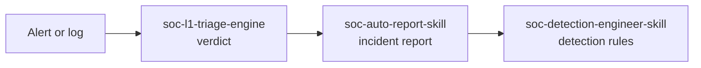

<div align="center">


<br/><br/>

[](https://www.linkedin.com/in/mohamedbenbouazza/)
[](https://substack.com/@benbouazza)
[](https://x.com/benbouazza_m)
[](https://linktr.ee/mbenbouazzam)
[](mailto:mbenbouazzam@gmail.com)

[](mailto:mbenbouazzam@gmail.com)

</div>

---

## Who I am

Network-trained cybersecurity technician, Morocco. I turn repetitive SOC work into open-source AI systems: analysts decide, systems do the first pass.

---

## Systems

| System | Problem it targets | Output | Activity |
|:---|:---|:---|:---|
| [**soc-l1-triage-engine**](https://github.com/mohamed-ai-sec/soc-l1-triage-engine) | L1 time lost on false positives | TP / FP / Ambiguous verdict, confidence X/5, MITRE mapping, escalation or closure note |   |
| [**soc-auto-report-skill**](https://github.com/mohamed-ai-sec/soc-auto-report-skill) | IR reporting takes hours and costs SLAs | 12-section report + PIR, detection queries, executive brief, regulatory notice, staff update |   |
| [**soc-detection-engineer-skill**](https://github.com/mohamed-ai-sec/soc-detection-engineer-skill) | Detection rules take days to write correctly | Structured draft rules in KQL, SPL, Sigma, EQL |   |
| [**sentinel-soc-ai**](https://github.com/mohamed-ai-sec/sentinel-soc-ai) | No senior analyst on every shift | L1 / L2 / L3 AI analyst |   |
| [**soc-ai-systems**](https://github.com/mohamed-ai-sec/soc-ai-systems) | No standard way to package SOC AI workflows | Master `SKILL.md` framework and docs |   |

Typical order of use. Each skill also works on its own.



Each repo has a **How it works** diagram:
[triage engine](https://github.com/mohamed-ai-sec/soc-l1-triage-engine#how-it-works) ·
[report skill](https://github.com/mohamed-ai-sec/soc-auto-report-skill#how-it-works) ·
[how a skill runs](https://github.com/mohamed-ai-sec/soc-ai-systems#how-a-skill-runs-in-claude)

---

## Install in Claude

1. Open **Customize → Skills**. Code execution and file creation must be on. *(Older versions: Settings → Capabilities → Skills.)*
2. Click **+**, then **Create skill**, then **Upload a skill**.
3. Upload the ZIP and toggle the skill on.
4. Ask: *"Use soc-l1-triage-engine on this alert: …"*

The ZIP needs the skill folder as its root:

```text
soc-l1-triage-engine.zip
└── soc-l1-triage-engine/        folder name = skill name
    └── SKILL.md
```

| If the upload fails | Fix |
|:---|:---|
| Root folder name doesn't match the skill `name` | GitHub's **Download ZIP** names it `repo-main`. Rename the folder, then zip it again. |
| Files sit directly in the ZIP root | Put them inside one skill folder. |
| The file isn't called `SKILL.md` | Rename it. |
| Invalid characters in name or description | Use lowercase letters, numbers and hyphens in the name. |

Uploaded skills are private to your account and don't sync between claude.ai, Claude Code and the API.

---

## How they're built

- **Plain text.** Every rule lives in a `SKILL.md` you can read, diff and change.
- **Defined structure.** The triage engine, for example, runs fixed phases (intake, five-dimension context, playbook, score, close-out) and always ends in the same verdict report.
- **Evidence before verdict.** The skills tell you what to check. You run the lookups and paste the results.

## Limits

- They don't connect to your SIEM or run threat-intel lookups.
- Output depends on the context you paste in.
- Confidence scores are a triage aid. Review before you close a ticket or send a report.
- They don't replace L2 investigation.

Caught a wrong verdict? Open an issue with a sanitized sample. Those are the most useful contributions.

---

## Stack


## On the list

`soc-phishing-skill` (phishing analysis pipeline) · `soc-enrichment-agent` (IOC enrichment)

## Writing

Build logs, failures and release notes: [Substack](https://substack.com/@benbouazza) · [LinkedIn](https://www.linkedin.com/in/mohamedbenbouazza/) · [X](https://x.com/benbouazza_m)

---

<div align="center">

**If one of these saved you a shift, star it. It helps other analysts find it.**


</div>
