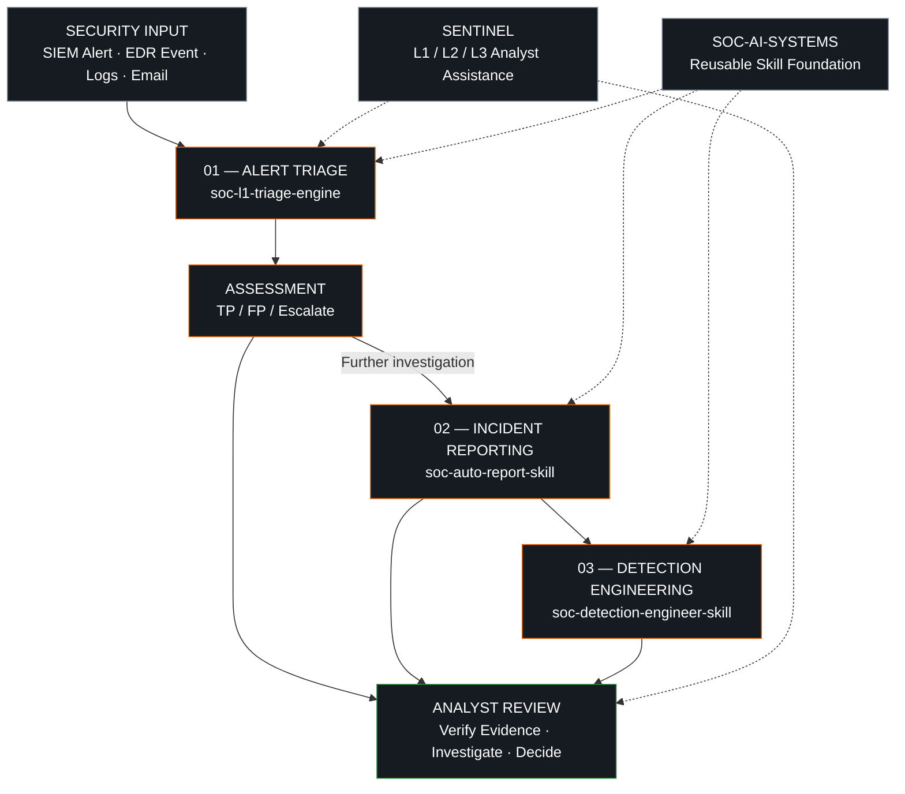

### Building AI-assisted systems for repetitive SOC operations.

I turn security alerts, investigation artifacts and detection requirements into structured, reviewable workflows.

 

---

## About

I'm Mohamed, a cybersecurity technician with a networking background, based in Morocco.

My focus is building practical AI-assisted systems for Security Operations Centers (SOC).

I work on a simple problem: security analysts spend significant time repeating operational tasks that can be structured, documented and assisted by reusable workflows.

My projects explore how **Claude, AI agents, `SKILL.md`, explicit rules and structured workflows** can support:

- Security alert triage.
- Incident investigation and reporting.
- Detection engineering.
- Phishing analysis.
- Repeatable SOC procedures.

The goal isn't to replace the analyst. It's to make the first pass more consistent, explainable and easier to review.

## Open-source SOC systems

Five repositories. Five different responsibilities within security operations.

| Repository | Purpose | Main output |
|---|---|---|
| [soc-l1-triage-engine](https://github.com/mohamed-ai-sec/soc-l1-triage-engine) | Structured L1 alert investigation | TP / FP / Escalate verdict, evidence and confidence |
| [sentinel-soc-ai](https://github.com/mohamed-ai-sec/sentinel-soc-ai) | Broader SOC analyst assistance | L1 / L2 / L3 investigation guidance |
| [soc-auto-report-skill](https://github.com/mohamed-ai-sec/soc-auto-report-skill) | Incident documentation | Structured 12-section incident report |
| [soc-detection-engineer-skill](https://github.com/mohamed-ai-sec/soc-detection-engineer-skill) | Detection engineering assistance | KQL, SPL, Sigma, EQL and other detection drafts |
| [soc-ai-systems](https://github.com/mohamed-ai-sec/soc-ai-systems) | Reusable SOC AI workflow foundation | Skill framework and documentation |

---

## System architecture

The projects address different stages of SOC operations. They are complementary standalone systems, not an already-integrated automated platform.

### How the workflow works

### 01. SOC L1 Triage Engine

**Repository:** [soc-l1-triage-engine](https://github.com/mohamed-ai-sec/soc-l1-triage-engine)

A structured approach to evaluating SOC alerts before escalation or closure.

Key capabilities:

- Five-dimensional context evaluation.
- True Positive / False Positive / Escalate verdicts.
- Confidence assessment.
- MITRE ATT&CK mapping.
- Alert-specific investigation playbooks.
- Evidence-based reasoning.

**Problem addressed:** Repetitive L1 alert analysis and inconsistent triage decisions.

### 02. SENTINEL — SOC Analyst AI

**Repository:** [sentinel-soc-ai](https://github.com/mohamed-ai-sec/sentinel-soc-ai)

A broader analyst-assistance framework designed around SOC investigation workflows.

Key capabilities:

- L1 / L2 / L3 investigation guidance.
- Phishing investigation.
- Security event analysis.
- KQL and SPL assistance.
- Explicit investigation and enforcement rules.

**Problem addressed:** Providing structured investigation guidance across different SOC responsibilities.

### 03. SOC Auto-Report Engine

**Repository:** [soc-auto-report-skill](https://github.com/mohamed-ai-sec/soc-auto-report-skill)

A reporting workflow that organizes supplied security artifacts into structured incident documentation.

Key capabilities:

- 12-section incident report.
- Executive summary.
- Incident timeline.
- IOC documentation.
- Detection recommendations.
- Multiple security data formats.

**Problem addressed:** Repetitive incident documentation and the time required to prepare consistent reports.

### 04. SOC Detection Engineer Skill

**Repository:** [soc-detection-engineer-skill](https://github.com/mohamed-ai-sec/soc-detection-engineer-skill)

A detection engineering assistant for structuring detection logic and rule development.

Supported detection formats and technologies include:

- KQL
- SPL
- Sigma
- EQL
- YARA
- Zeek
- Falco
- auditd

Key focus areas:

- Detection logic.
- Telemetry assessment.
- Input confidence.
- Rule validation.
- False-positive considerations.

**Problem addressed:** Making detection engineering workflows more structured, transparent and reviewable.

### 05. SOC AI Systems

**Repository:** [soc-ai-systems](https://github.com/mohamed-ai-sec/soc-ai-systems)

The reusable foundation behind my approach to packaging SOC AI workflows.

Focus areas:

- `SKILL.md` structure.
- Reusable instructions.
- Documentation.
- Workflow organization.
- Open-source distribution.

**Problem addressed:** Making SOC AI workflows easier to package, understand and reuse.

---

## Engineering principles

I build around a few rules:

| Principle | Implementation |
|---|---|
| Evidence first | Conclusions must be supported by supplied evidence. |
| No invented IOCs | Missing indicators remain missing. |
| No fabricated timestamps | Unknown timestamps are not reconstructed as facts. |
| Visible uncertainty | Distinguish observed, suspected, confirmed and unknown. |
| Structured output | Use defined formats for repeatable results. |
| Human oversight | Analysts verify findings and make security decisions. |

**AI assists the investigation. The analyst owns the decision.**

## Technology stack

## Installation and usage

Each repository contains its own source files and installation instructions.

For projects packaged as Claude Skills:

1. Open the repository.
2. Read its installation instructions.
3. Inspect the `SKILL.md` and supporting files.
4. Follow the documented installation method.
5. Provide a sanitized security artifact.
6. Review the generated output against the original evidence.

Start with the [SOC L1 Triage Engine](https://github.com/mohamed-ai-sec/soc-l1-triage-engine).

Installation requirements can differ between projects.

## Development roadmap

- [ ] Publish reproducible demonstrations for each project.
- [ ] Expand phishing investigation workflows.
- [ ] Add more sanitized investigation examples.
- [ ] Improve detection validation and testing.
- [ ] Document edge cases and limitations.
- [ ] Continue improving reusable SOC skills.

## Contributions and feedback

Found an incorrect verdict, unsupported assumption or an edge case?

Open an issue in the relevant repository.

Useful reports include:

- A sanitized input example.
- The generated output.
- The unexpected behavior.
- The expected behavior.

Never include real credentials, confidential logs or sensitive organizational data.

## Connect

I'm interested in cybersecurity, SOC operations, detection engineering and practical AI automation.

- LinkedIn: [Mohamed Benbouazza](https://www.linkedin.com/in/mohamedbenbouazza/)
- GitHub: [mohamed-ai-sec](https://github.com/mohamed-ai-sec)
- Substack: [Technical writing](https://substack.com/@benbouazza)
- X: [@benbouazza_m](https://x.com/benbouazza_m)
- Email: [mbenbouazzam@gmail.com](mailto:mbenbouazzam@gmail.com)

---

**Built in public. Documented with evidence. Open source.**

